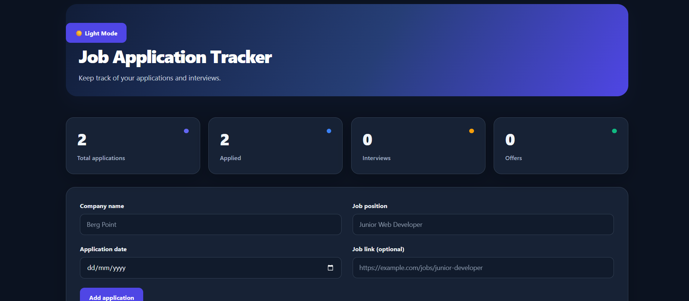

# Job Application Tracker

A modern, responsive job application management dashboard built with **Vue.js and Vite**.

This application helps job seekers organize their applications, monitor recruitment progress, and manage their job search from one dashboard.

## Dashboard Preview



## Features

- **Application Management:** Add, edit, and delete job applications.
- **Status Tracking:** Track applications as Applied, Interview, Offer, or Rejected.
- **Analytics Dashboard:** View application statistics and visual progress charts.
- **Search and Filtering:** Find applications by company name and filter by status.
- **Dark and Light Mode:** Switch between themes with saved preferences.
- **Local Storage:** Application data remains available after refreshing the browser.
- **Responsive Design:** Optimized for desktop and mobile screens.
- **Job Links:** Save and access original job advertisements.

## Technologies Used

- Vue.js 3
- JavaScript
- Vite
- CSS3
- HTML5
- Browser Local Storage

## Dashboard Preview


## Getting Started

Clone the repository, open the project directory, and install the dependencies:

```bash
npm install
```

Start the development server:

```bash
npm run dev
```

Create a production build:

```bash
npm run build
```

## How It Works

1. Enter the company name, job position, application date, and optional job link.
2. Click **Add application** to save the record.
3. Update the application status as your recruitment process progresses.
4. Monitor your statistics and analytics charts.
5. Search, edit, or delete applications whenever necessary.

## Future Improvements

- Interview scheduling and reminders
- Application notes and follow-up dates
- CSV export
- Additional analytics and visualizations

## Author

**Kyrian — Frontend Web Developer**

GitHub: [kyrian-dev](https://github.com/kyrian-dev)

## License

Created as a personal portfolio project for learning and demonstrating frontend development skills.